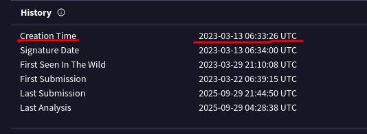
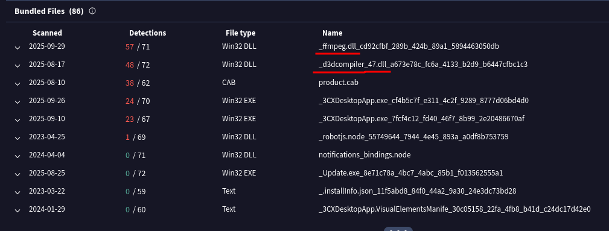
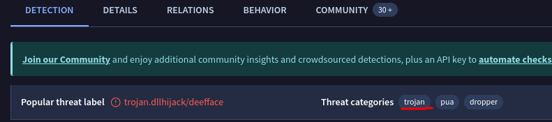
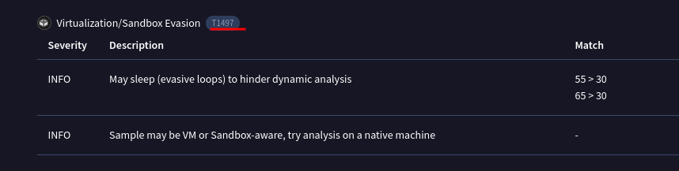
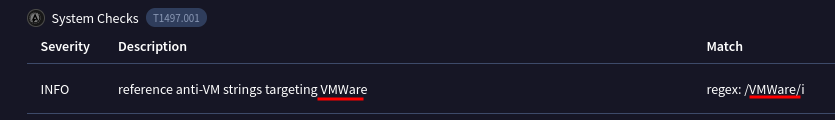
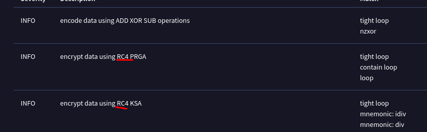
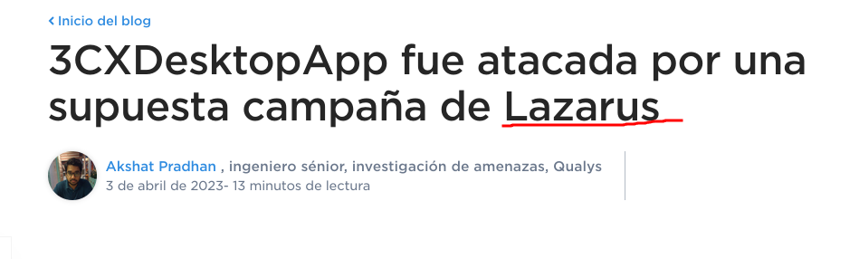
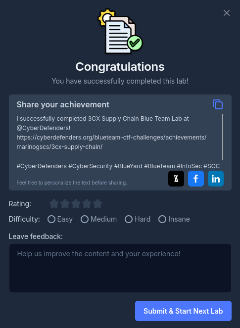

## Caso 3CX Supply Chain

>Una gran multinacional depende en gran medida del software 3CX para las comunicaciones telefónicas, lo que lo convierte en un componente crítico de sus operaciones comerciales. Tras una reciente actualización de la aplicación de escritorio 3CX, las alertas antivirus señalan casos esporádicos en los que el software se borra de algunas estaciones de trabajo, mientras que otras no se ven afectadas. El equipo de TI descarta esto como un falso positivo y pasa por alto las alertas, pero luego observa un rendimiento degradado y un tráfico de red extraño hacia servidores desconocidos. Los empleados informan de problemas con la aplicación 3CX y el equipo de seguridad informática identifica patrones de comunicación inusuales relacionados con las recientes actualizaciones de software.
>Como analista de inteligencia de amenazas, es su responsabilidad examinar este posible ataque a la cadena de suministro. Sus objetivos son descubrir cómo los atacantes comprometieron la aplicación 3CX, identificar al posible autor de la amenaza y evaluar el alcance global del incidente.

### Q1/ Comprender el alcance del ataque e identificar qué versiones muestran un comportamiento malicioso es fundamental para tomar decisiones informadas si estas versiones comprometidas están presentes en la organización. ¿Cuántas versiones de 3CX que se ejecutan en Windows han sido marcadas como malware?

>Para poder encontrar las versiones de 3CX que son detectadas como malware hacemos una búsqueda por internet y en la página de fortinet se nos dice que son dos la **18.12.407 y 18.12.416**.

### Q2/ Determinar la antigüedad del malware puede ayudar a evaluar el alcance del compromiso y realizar un seguimiento de la evolución de las familias y variantes de malware. ¿Cuál es la hora de creación UTC del malware .msi?

>Para encontrar la fecha de la creación del malware usamos la herramienta de VirusTotal introducimos el hash del archivo que se nos proporcionó para la investigación y cuando nos haga la búsqueda accedemos al apartado de detalles y en la parte de History encontraremos la fecha de creación del malware.

### Q3/ Los archivos ejecutables (.exe) se utilizan con frecuencia como cargas útiles de malware primarias o secundarias, mientras que las bibliotecas de vínculos dinámicos (.dll) suelen cargar código malicioso o mejorar la funcionalidad del malware. El análisis de los archivos depositados por el instalador de software de Microsoft (.msi) es fundamental para identificar los archivos maliciosos e investigar todo su potencial. ¿Qué DLL maliciosas fueron depositadas por el archivo .msi?

>Para encontrar los DLL maliciosos depositados por el archivo .msi seguimos usando la herramienta VirusTotal esta vez en el apartado de **Relations** y bajamos hasta la parte de bundled files donde encontramos el nombre de los dos archivos DLL.

### Q4/ Reconocer las técnicas de persistencia utilizadas en este incidente es esencial para las estrategias de mitigación actuales y las futuras mejoras en materia de defensa. ¿Cuál es la identificación de técnica MITRE ATT&CK empleada por los archivos .msi para cargar la DLL maliciosa?

>Para saber qué técnica MITRE ATT&CK es usada para cargar los archivos entramos al apartado de **behavior** en VirusTotal y desplegamos una pestaña que se llama **Defense evasion** en la que si bajamos encontramos que para cargar los DLL se usó la técnica **T1574**

### Q5/ Reconocer el tipo de malware (categoría de amenaza) es esencial para su investigación, ya que puede ofrecer información valiosa sobre las posibles acciones maliciosas que va a examinar. ¿Cuál es la categoría de amenaza de los dos DLL maliciosos?

>Para encontrar la categoría de la amenaza ingresamos al apartado de **detection** de VirusTotal donde vemos que está categorizada como **Trojan**.

### Q6/ Como analista de inteligencia de amenazas que realiza análisis dinámicos, es fundamental comprender cómo el malware puede evadir la detección en entornos virtualizados o sistemas de análisis. Este conocimiento le ayudará a mitigar o abordar eficazmente estas tácticas evasivas. ¿Cuál es el ID MITRE de las técnicas de evasión de virtualización/sandbox utilizadas por las dos DLL maliciosas?

>Para saber cuál técnica MITRE ATT&CK usan para evadir la virtualización/sandbox accedemos al apartado de comportamiento de VirusTotal donde en la parte de **defense evasion** podemos encontrar la que usan que es **T1497**.

### Q7/ Al realizar análisis de malware e ingeniería inversa, es fundamental comprender las técnicas antianálisis para evitar perder tiempo. ¿Qué hipervisor es el objetivo de las técnicas antianálisis del archivo ffmpeg.dll?

>Para encontrar el hipervisor que desea evitar el archivo **ffmpeg.dll** entramos al apartado de **behavior** de VirusTotal en el que si desplegamos **defense evasion** y bajamos podemos encontrar que el hipervisor que desea evadir es **VMWare**.

### Q8/ Identificar el método criptográfico utilizado en el malware es fundamental para comprender las técnicas empleadas para eludir los mecanismos de defensa y ejecutar sus funciones por completo. ¿Qué algoritmo de cifrado utiliza el archivo ffmpeg.dll?

>En el mismo apartado de **behavior** y desplegando nuevamente **defensive evasion** podemos encontrar que el método de encriptación que usa es el **RC4**.

### Q9/ Como analista, ha reconocido algunas Tácticas, Técnicas y Procedimientos (TTP) implicadas en el incidente, pero identificar al grupo Amenaza Persistente Avanzada (APT) responsable le ayudará a buscar sus TTP habituales y descubrir otras posibles actividades maliciosas. ¿Qué grupo es el responsable de este ataque?

>Buscando por internet encontramos que el ataque fue hecho por una supuesta campaña de un grupo llamado **Lazarus**.

Siguiente Write-up: [lab_09 PsExec Hunt](../Lab_09%20PsExec%20Hunt/lab_09%20PsExec%20Hunt.md)