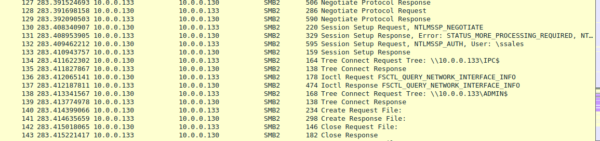
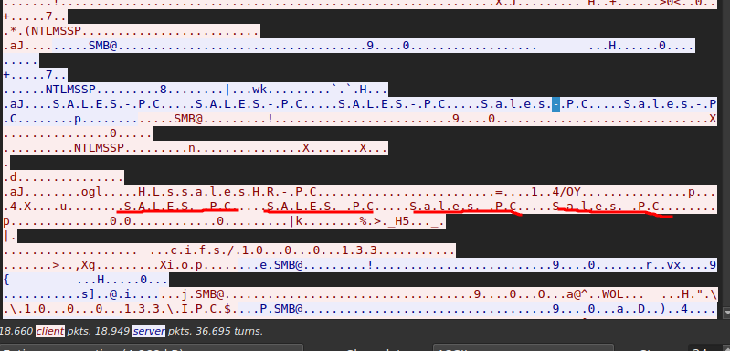
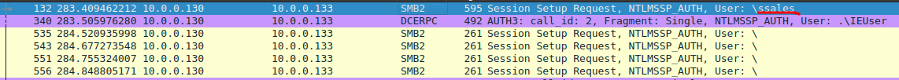
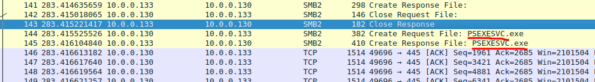
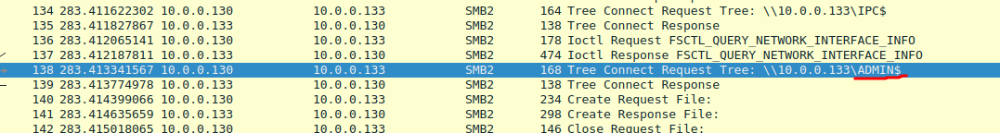
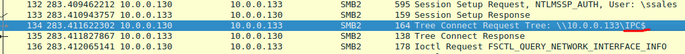
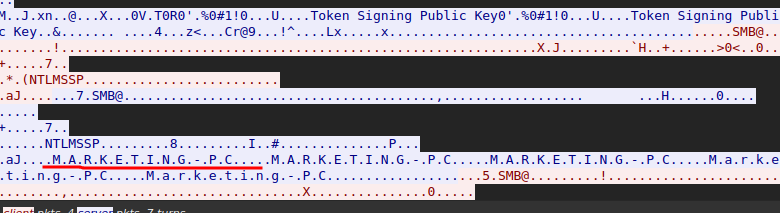

## Caso PsExec Hunt

>Una alerta del sistema de detección de intrusiones (IDS) ha señalado una actividad sospechosa de movimiento lateral relacionada con PsExec. Esto indica un posible acceso no autorizado y movimiento a través de la red. Como analista del centro de operaciones de seguridad (SOC), su tarea consiste en investigar el archivo PCAP proporcionado para rastrear las actividades del atacante. Identifique su punto de entrada, los equipos atacados, el alcance de la brecha y cualquier indicador crítico que revele sus tácticas y objetivos dentro del entorno comprometido.

### Q1/ Para rastrear eficazmente las actividades del atacante dentro de nuestra red, ¿puede identificar la dirección IP del equipo desde el que el atacante obtuvo inicialmente el acceso?

>Revisando en Wireshark me di cuenta de algunos comportamientos raros de parte de la IP **10.0.0.130** con tráfico sospechoso que contiene solicitudes de creación de archivos y demás actividades sospechosas.

### Q2/ Para comprender plenamente el alcance de la infracción, ¿puede determinar el nombre de host de la máquina a la que el atacante accedió primero?

>Haciendo un follow TCP en uno de los paquetes de tráfico de red podemos encontrar el nombre del host de la primera máquina a la que accedió el atacante que es **SALES-PC**.

### Q3/ Conocer el nombre de usuario de la cuenta de que utilizó el atacante para autenticarse nos dará una idea del alcance de la violación. ¿Cuál es el nombre de usuario utilizado por el atacante para autenticarse?

>Para conocer el nombre del usuario utilizado filtramos los paquetes con el siguiente comando de búsqueda **`ntlmssp.auth.username`** una vez hecho eso vemos que el usuario es **ssales**.

### Q4/ Después de averiguar cómo se movió el atacante dentro de nuestra red, necesitamos saber qué hizo en la máquina objetivo. ¿Cuál es el nombre del ejecutable del servicio que el atacante configuró en el objetivo?

>En uno de los paquetes en los que el atacante creó un archivo nuevo se puede ver el ejecutable que configuró el atacante, se llama **PSEXESVC.exe**.

### Q5/ Necesitamos saber cómo instaló el atacante el servicio en el equipo comprometido para comprender sus tácticas de movimiento lateral. Esto puede ayudar a identificar otros sistemas afectados. ¿Qué recurso compartido de red utilizó PsExec para instalar el servicio en el equipo de destino?

>En una de las capturas podemos ver que el recurso compartido al que se conecta es **ADMIN$**. El **tree connect** significa que se está conectando a un recurso compartido del servidor

### Q6/ Debemos identificar el recurso compartido de red utilizado para la comunicación entre las dos máquinas. ¿Qué recurso compartido de red utilizó PsExec para la comunicación?

>Al igual que en la pregunta anterior lo que nos da la pista de que se quiere acceder a un recurso compartido es el **tree connect** y viendo en las capturas de tráfico se ve que el atacante accede al recurso compartido **IPC$**. 

### Q7/ Ahora que tenemos una imagen más clara de las actividades del atacante en la máquina comprometida, es importante identificar cualquier otro movimiento lateral. ¿Cuál es el nombre de host de la segunda máquina a la que el atacante apuntó para pivotar dentro de nuestra red?

>Siguiendo la línea del tiempo, observamos que la siguiente máquina que atacó el atacante fue la que tiene ip **10.0.0.131** que al hacer un follow TCP del paquete vemos que el nombre del host de esa máquina es **MARKETING-PC**. 

Siguiente Write-up: [Lab_10 IcedID](../Lab_10%20IcedID/Lab_10%20IcedID.md)